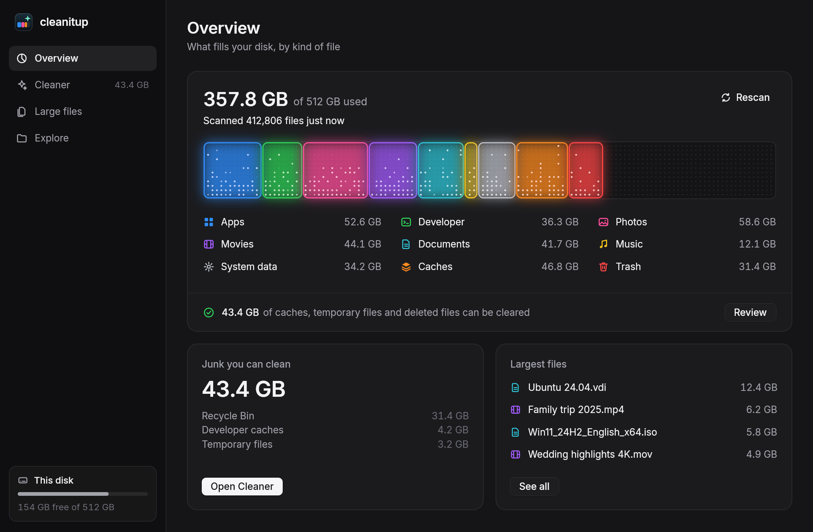
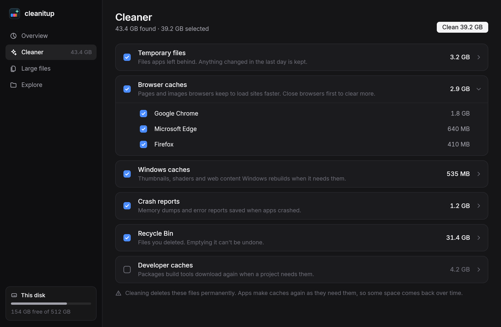

# cleanitup

A native disk cleaner built with [Rune](https://github.com/anomalyco/rune). It scans your disk,
shows what fills it, cleans junk, and lets you remove large files and folders.



## Run it on Windows

Double-click `cleanitup.exe`. It needs nothing else installed. Windows SmartScreen may warn
because the file isn't signed: choose **More info**, then **Run anyway**.

To also clean `C:\Windows\Temp`, right-click `cleanitup.exe` and choose **Run as administrator**.

## What it does

- **Overview**: how much of the disk each kind of file takes (apps, photos, movies, documents,
  caches, the Recycle Bin and more). Click a category to see its largest files.
- **Cleaner**: finds temporary files, browser caches (Chrome, Edge, Brave, Vivaldi, Opera,
  Firefox), Windows caches (thumbnails, internet cache, shader caches), crash dumps and error
  reports, the Recycle Bin, and developer caches (npm, Yarn, pip, Cargo, Gradle, NuGet, Go).
  Tick what to clean and press **Clean**.
- **Large files**: the biggest files in your user folder, filterable by kind.
- **Explore**: every folder by size. Click a folder to open it.

In Large files and Explore, tick items, then:

- **Move to Recycle Bin**: you can restore them from the Recycle Bin.
- **Delete permanently**: skips the Recycle Bin and can't be undone.
- **Show in Explorer**: opens the folder with the item selected. Each row also has this as an icon.

Every action asks first, shows its progress, and then reports what it freed and anything it
couldn't remove.



## How it keeps your files safe

- The Cleaner deletes what is *inside* the cache and temp folders, never the folders themselves.
- It never follows links or junctions, so nothing outside those folders is touched.
- In temp folders, files changed in the last day are kept; apps may still be using them.
- Files an app has open are skipped and counted in the report.
- Developer caches are off by default.
- Some things can't be selected: your user folder and its main folders (Documents, Desktop,
  Downloads, Pictures and so on, though anything inside them can be selected), `AppData\Local`
  and `AppData\Roaming` themselves, installed apps (uninstall those from Settings), anything
  outside your user folder, and what is already in the Recycle Bin (empty it from Cleaner).
- Selecting app data, such as a folder inside `AppData`, shows a warning before you confirm.

## Build from source

1. Install Rust from https://rustup.rs. On Windows, accept the "Desktop development with C++"
   build tools it offers.
2. In this folder:

```bash
cargo run --release
```

`rust-toolchain.toml` fetches the Rust version Rune is built with. On Linux, first install
`libxkbcommon-dev libwayland-dev libxkbcommon-x11-0`.

To run the tests (the delete and lock rules):

```bash
cargo test --release
```

## Try it without touching your disk

`--scene demo` loads a made-up Windows machine. Every action in it is simulated.

```bash
cargo run --release -- --scene demo
```

Rune apps also render headless, which is how the screenshots and `demo.mp4` were made:

```bash
cargo run --release -- --snap shot.png --scene demo --at 12
```

## Layout

- `src/scan.rs`: walks the disk into a tree of folder sizes and keeps the largest files.
- `src/junk.rs`: the Cleaner's locations for each OS, and the measuring and cleaning sweep.
- `src/ops.rs`: Recycle Bin moves, permanent deletes and cleans, on a background thread.
- `src/app.rs`: app state, selection, lock rules, and how results update the tree.
- `src/overview.rs`, `src/pages.rs`, `src/frame.rs`: the UI.
- `src/demo.rs`: the demo machine.
- `assets/`: the app icon (`cleanitup.ico` for Windows, PNGs elsewhere) and `cleanitup.rc`,
  which `build.rs` embeds into the Windows executable.
